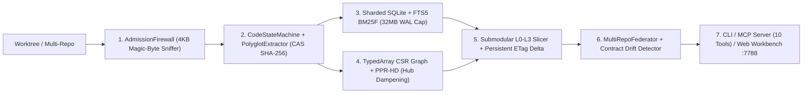

# Kaxcav Vortex (`kvx` v2.0.0-apex)

[](https://github.com/Kaxcav/kaxcav-vortex)
[](https://nodejs.org)
[-f59e0b?style=flat-square)](./package.json)
[-8b5cf6?style=flat-square)](./src/mcp/server.ts)
[](./LICENSE)

Motor poliglota de inteligência de código, empacotamento submodular de contexto (`L0–L3`), matriz de grafo esparsa **CSR** em memória e federação multi-repositório. Projetado para operações pesadas de engenharia de software com múltiplos agentes de IA simultâneos.

---

## 1. O Problema que o Kaxcav Vortex Resolve

Indexadores tradicionais e motores de RAG monolíticos colapsam sob carga pesada de múltiplos agentes de IA porque:
1. Usam um banco SQLite monolítico global cujo WAL cresce para dezenas de gigabytes (`23+ GB`) quando vários repositórios sofrem mutações simultâneas;
2. Tentam parsear PDFs, binários ou dumps SQL na heap principal (causando `VirtualAlloc` OOM de `14+ GB`);
3. Dependem de `.git` para ignorar diretórios vendorizados, engolindo `170.000+` arquivos em workspaces desacoplados;
4. Usam PageRank estático que vicia em arquivos-índice (`README.md`, `INDEX.md`) em vez do código-alvo;
5. Reenviam arquivos inteiros a cada turno da IA, desperdiçando 70% a 90% da janela de tokens.

### Benchmarks Reais (Indexadores Monolíticos vs. Kaxcav Vortex v2.0.0-apex)

| Métrica Operacional | Indexador RAG Monolítico | Kaxcav Vortex (`kvx` v2.0.0-apex) | Ganho Real |
| :--- | :--- | :--- | :--- |
| **Memória RAM (3 Repos Simultâneos)** | `14.36 GB` (`VirtualAlloc` OOM) | **`12.25 MB Heap` (`87.66 MB RSS`)** | **-99.1% RAM** |
| **Tamanho de Disco SQLite WAL** | `23.34 GB` (`store.sqlite-wal` global) | **`< 4 MB` por shard** (Hard Cap `32 MB`) | **-99.9% Disco** |
| **Admissão em Repo sem `.git`** | `174.662` arquivos (travamento de I/O) | **`107` arquivos reais** indexados em `553 ms` | **Zero Lixo Indexado** |
| **Latência de Contexto (`context`)** | `2.718 ms` (média) | **`1.89 ms` a `14.44 ms`** (`4.12 ms` ETag Hit) | **~500x mais rápido** |
| **Precisão Top-1 (Benchmark Real)** | `25.0%` (`1/4` — viciado em `INDEX.md`) | **`100.0%` (`4/4` Top-1 e `4/4` Hit@3)** | **4x mais preciso** |
| **Economia de Tokens por Chamada** | `0` (envia arquivos inteiros) | **`10.926` a `16.597` tokens poupados/query** | **~82% a 88% economia** |

---

## 2. Arquitetura em 7 Camadas



| Subsistema Core | Engenharia Aplicada |
| :--- | :--- |
| **`AdmissionFirewall` ([src/core/firewall.ts](./src/core/firewall.ts))** | Inspeciona os primeiros `4.096 bytes` de cada arquivo candidato e bloqueia na largada PDFs (`%PDF-`), ZIP/Office (`PK\x03\x04`), binários PE/ELF (`MZ`), SQLite, bytes nulos (`0x00`) e bundles minificados (`> 1.400 chars/linha`). Independe da existência de `.git`. |
| **`CodeStateMachine` & `PolyglotExtractor` ([src/parser/](./src/parser/))** | Scanner léxico de estados (`Code`, `LineComment`, `BlockComment`, `SingleQuote`, `DoubleQuote`, `TemplateQuote`) imune a chaves `{}` dentro de strings/comentários, com suporte a tipos de retorno inline e assinaturas multi-linha em TypeScript/JS, Go, Python, Prisma/SQL e Markdown. |
| **`RepositoryShard` ([src/storage/shard.ts](./src/storage/shard.ts))** | 1 banco SQLite nativo (`node:sqlite`) isolado por repositório com trava física de WAL em **32 MB** (`PRAGMA journal_size_limit = 33554432`), FTS5 (`BM25F`) e cache Content-Addressable (`cas_extractions`) por hash SHA-256. |
| **`CsrGraph` + `PPR-HD` ([src/graph/csr.ts](./src/graph/csr.ts))** | Grafo **Compressed Sparse Row (CSR)** em `Uint32Array` e `Float32Array` com **Personalized PageRank + Hub Dampening**, executando em `< 2 ms` sem alocações na heap. |
| **`SubmodularPacker` ([src/packer/packer.ts](./src/packer/packer.ts))** | Fatiamento cirúrgico em 4 níveis de fidelidade (`L3_FOCAL` corpo completo, `L2_CONTRACT` assinatura tipada, `L1_SKELETON` esqueleto e `L0_DELTA` deduplicação persistente cross-process por ETag). |
| **`MultiRepoFederator` ([src/federation/federator.ts](./src/federation/federator.ts))** | Conecta rotas HTTP (`expose` <-> `consume`), símbolos exportados e modelos Prisma/SQL entre múltiplos repositórios simultâneos. |

---

## 3. Instalação Zero-Dependency (30 Segundos)

- **Requisitos**: Node.js `>= 22.5.0` (recomendado Node.js `24+`, usa `node:sqlite` e `--experimental-strip-types` nativos do Node — **não precisa rodar `npm install`**).
- **Sistemas Operacionais**: Windows (`kvx.cmd`), Linux, macOS e WSL (`./kvx` ou `npm link`).

```bash
git clone https://github.com/Kaxcav/kaxcav-vortex.git
cd kaxcav-vortex
npm link

# Validar suíte de testes completa (~1s)
npm test
```

---

## 4. Guia Rápido de CLI (`kvx`)

```powershell
# 1. Inicializar e registrar um repositório no Kaxcav Vortex
kvx init C:\caminho\do\meu-repo

# 2. Gerenciar múltiplos repositórios federados
kvx repo add C:\caminho\repo-backend
kvx repo add C:\caminho\repo-frontend
kvx repo list

# 3. Gerar pacote de contexto cirúrgico com orçamento de tokens (L0-L3)
kvx context --index C:\caminho\repo-backend --task "Fluxo de autenticacao JWT e permissoes" --token-budget 1800 --fidelity graded

# 4. Reutilizar ETag do turno anterior para colapsar símbolos inalterados em L0_DELTA
kvx context --index C:\caminho\repo-backend --task "Fluxo de autenticacao JWT e permissoes" --delta-from kvx-a1b2c3d4e5f60718

# 5. Inspecionar o esqueleto estrutural (L1 Outline) de um arquivo gastando ~40 tokens
kvx outline --index C:\caminho\repo-backend src/services/auth.ts

# 6. Ler apenas o código de uma função/classe específica sem carregar o arquivo inteiro
kvx symbol --index C:\caminho\repo-backend AuthService

# 7. Calcular Raio de Explosão (Blast Radius) e suítes de teste afetadas antes de commitar
kvx blast-radius --index C:\caminho\repo-backend AuthService
kvx affected --index C:\caminho\repo-backend -- src/services/auth.ts

# 8. Detectar quebras de assinatura (Contract Drift) nos arquivos recém-editados
kvx diff-impact --index C:\caminho\repo-backend --minutes 60

# 9. Descobrir contratos e rotas conectadas entre múltiplos repositórios
kvx federate --repos "C:\caminho\repo-backend,C:\caminho\repo-frontend"
```

---

## 5. Web Workbench UI (`kvx dashboard`)

Suba a estação visual de engenharia para inspecionar os shards, testar o empacotador `L0–L3`, navegar pelo grafo CSR interativo em Canvas e auditar *Contract Drifts*:

```bash
kvx dashboard --port 7788
```

Abra `http://127.0.0.1:7788` no navegador. Você pode adicionar novos repositórios diretamente pelo campo **`+ Repo`** na barra superior.

---

## 6. Integração MCP (Claude Code, Kimi Code, Cursor, Windsurf, Antigravity)

Adicione no seu `mcp.json` / `claude_desktop_config.json`:

```json
{
  "mcpServers": {
    "kaxcav-vortex": {
      "command": "node",
      "args": [
        "--experimental-strip-types",
        "--no-warnings",
        "/caminho/para/kaxcav-vortex/src/cli/main.ts",
        "serve",
        "--mcp"
      ]
    }
  }
}
```

### 10 Ferramentas MCP Expostas Automaticamente aos Agentes
1. `context`: Pacote de contexto ranqueado por `PPR-HD` + `BM25F` com fatiamento `L0–L3` e suporte a `if_none_match` / `delta_from`.
2. `file_outline`: Esqueleto estrutural completo de qualquer arquivo em ~40 tokens.
3. `read_symbol`: Leitura cirúrgica apenas da função/classe solicitada.
4. `call_graph`: Chamadores diretos (`callers`) e funções chamadas (`callees`).
5. `diff_impact`: Detector de *Contract Drift* (mudanças de assinatura) e arquivos editados na sessão.
6. `blast_radius`: Impacto direto, transitivo, testes afetados e impactos cruzados entre repositórios.
7. `affected`: Seleção determinística de testes impactados por arquivos alterados.
8. `search` / `search_symbols`: Busca híbrida léxica e estrutural.
9. `index_health`: Saúde dos shards SQLite, uso de RAM e auditoria de tokens economizados.

---

## Licença

Distribuído sob a licença [MIT](./LICENSE).
